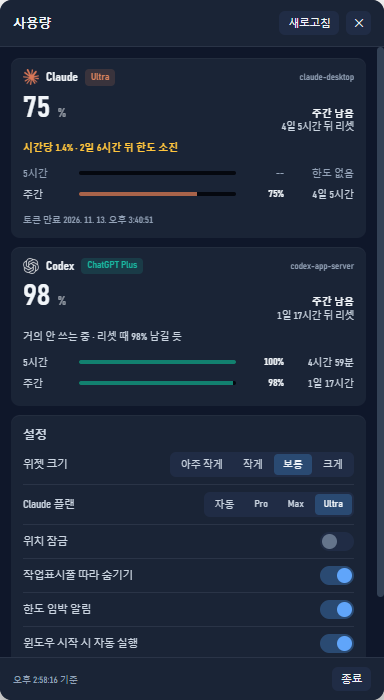

# AI Usage Meter

**Claude Code**와 **Codex CLI**의 남은 사용량을 터미널 없이 보는 Windows 데스크톱 스트립.

<p align="center">
  
</p>

목적은 두 가지다.

- **한도가 떨어져 작업이 끊기는 것**을 막는다.
- **리셋 전에 다 쓰지 못해 버리는 것**을 막는다.

그래서 화면에 띄우는 값은 **남은 %**와 **리셋까지 남은 시간**이다. 토큰 개수는 쓰지 않는다.

[English README](README.md) · [구현 노트](docs/NOTES.ko.md)

---

## 무엇을 해 주나

| | |
|---|---|
| **항상 떠 있는 스트립** | 두 서비스 각각 5시간(`5H`)·주간(`WK`) 두 줄. 막대, 남은 %, 리셋까지 |
| **작업표시줄 따라가기** | 자동 숨김 작업표시줄이 내려가면 같이 사라지고, 올라오면 같이 나타난다 |
| **드래그로 위치 조절** | 스트립 전체가 드래그 영역. 부팅할 때 저장된 자리로 돌아온다. 잠글 수 있다 |
| **소비 속도 예측** | 남은 %만으로 기울기를 구한다. `2일 1시간 뒤 소진`, `리셋 때 62% 남길 듯` |
| **임계값 알림** | 25%·10% 남았을 때, 그리고 이 속도면 리셋 전에 바닥날 때 |
| **윈도우 시작 시 실행** | 앱 안에서 켜고 끈다 |
| **상세 팝업** | 스트립을 누르면 두 창, 플랜, 토큰 출처, 설정이 한 화면에 |

<p align="center">
  
</p>

## 설치

[Releases](../../releases)에서 `AI Usage Meter-<버전>-setup.exe`를 받아 실행한다.
사용자 폴더에 설치되고 관리자 권한이 필요 없다.

설치본에 **코드 서명이 없다.** 처음 실행할 때 SmartScreen이 막는다
(*추가 정보 → 실행*). 아래 [신뢰](#신뢰)를 먼저 읽고 정하는 편이 낫다.

소스에서 바로 실행:

```bash
git clone https://github.com/jj8127/ai-usage-meter.git
cd ai-usage-meter
npm install
npm run widget
```

설치본 만들기:

```bash
npm run dist
```

## 필요한 것

- **Windows 10/11.** 작업표시줄 추적만 Win32에 묶여 있다.
- **Claude Code나 Codex CLI에 이미 로그인되어 있을 것.** 이 도구는 그 세션을 읽을 뿐,
  비밀번호를 묻지 않고 로그인을 만들지도 못한다.
- 소스에서 빌드할 때만 Node 20+와 npm.

## 신뢰

이 도구는 이미 컴퓨터에 있는 자격 증명을 읽는다. 어떻게 읽는지 알고 쓰는 편이 낫다.

**Claude 토큰을 찾는 순서:**

1. **Claude 데스크톱** — 로컬 자격 증명 저장소를 Windows DPAPI(`CryptUnprotectData`)와
   AES-256-GCM으로 푼다. Chromium이 쓰는 것과 같은 방식이다. DPAPI는 로그인한 Windows
   사용자에게만 풀어 주므로, 본인 계정에서만 동작한다.
2. **Claude CLI** — `~/.claude/.credentials.json`.
3. 환경변수 **`CLAUDE_CODE_OAUTH_TOKEN`**.

Codex 사용량은 Codex CLI의 `app-server`에서 stdio JSON-RPC로 받는다. 파일을 뒤지지 않는다.

**밖으로 나가는 것:** 1분에 한 번 `GET https://api.anthropic.com/api/oauth/usage`,
그리고 Codex CLI 자신의 호출. 그 외에는 없다. 수집도, 분석도, 업데이트 서버도, 계정도 없다.

**디스크에 남는 것:** 정규화된 사용량 수치와 예측 표본이
`%LOCALAPPDATA%\ai-usage-collector\`에 남는다. **토큰은 적지 않는다.** 테스트가 이것을 확인한다.

```
✔ 저장 파일에 토큰처럼 보이는 문자열이 없다
```

자격 증명 저장소를 복호화하는 동작이라, 백신이 의심하는 경우가 있다. 그 패턴에 대한
합리적인 반응이지 숨긴 것이 있다는 뜻은 아니다. 그 일을 하는 코드는
[`src/dpapi.js`](src/dpapi.js)와 [`src/claude.js`](src/claude.js), 합쳐서 200줄 남짓이다.

## 구조

```
src/claude.js   토큰 경로 -> GET /api/oauth/usage -> 정규화된 창
src/codex.js    codex app-server 실행 -> account/rateLimits/read
src/forecast.js 남은 % 표본으로 최소제곱 기울기
src/alerts.js   임계값·예측 알림, 창마다 한 번만
src/cache.js    마지막 실측값 디스크 저장, TTL 60초, 429 백오프
app/            Electron 스트립, 팝업, 트레이, 직접 그린 알림 창
```

깨지기 쉬운 곳 두 군데만 적어 둔다.

- **리셋 창은 분 단위로 키를 만든다.** Anthropic의 `resets_at`은 응답마다 마이크로초가
  다르다. 그대로 키로 쓰면 예측 표본이 쌓이지 않고 알림이 폴링마다 반복된다.
- **작업표시줄 판정은 PowerShell이 아니라 C#에서 한다.**
  `powershell -File app/taskbar-watch.ps1 --dump`로 지금 판정과 근거를 볼 수 있다.

막다른 길까지 전부 적은 긴 버전은 [docs/NOTES.ko.md](docs/NOTES.ko.md)에 있다.

## 한계

- **Windows 전용.** macOS·Linux 빌드는 없다.
- **플랜 이름은 토큰에 박혀 온다.** 토큰 발급 시점에 고정된다. 2026년 10월 Anthropic이
  Max 20x를 Ultra로 바꾼 뒤에도 옛 토큰은 `max_5x`라고 말한다. 설정에서 직접 고를 수 있다.
- **Ultra에는 5시간 한도가 없다.** 그 줄은 0%가 아니라 `한도 없음`으로 나온다.
- 개발 PC에서 Windows 토스트가 끝내 뜨지 않아, 알림 창을 직접 그린다.

## 개발

```bash
npm test              # 테스트 61개, node --test
npm run widget        # 소스에서 실행
npm run pack          # 설치본 없이 폴더만
npm run dist          # NSIS 설치본
```

눈으로 확인하기 어려운 것들을 위한 플래그: `--shot <폴더>`(스트립·팝업·알림 캡처),
`--clicktest`, `--holdtest`, `--tbtest`, `--scaletest`, `--motiontest`, `--livecheck`,
`--testnotify`, `--trace`.

## 라이선스

MIT. [LICENSE](LICENSE) 참고.
