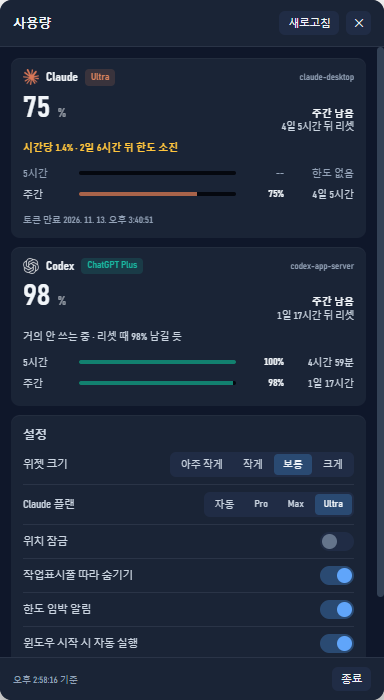

# AI Usage Meter

A Windows desktop strip that shows how much **Claude Code** and **Codex CLI** quota you
have left — without opening a terminal.

<p align="center">
  
</p>

It answers two questions you would otherwise answer by guessing:

- **Am I about to get cut off mid-task?**
- **Will I waste quota I never used before it resets?**

So every number on screen is **percent left** and **time until reset** — never a token count.

[한국어 README](README.ko.md) · [Implementation notes (ko)](docs/NOTES.ko.md)

---

## What you get

| | |
|---|---|
| **Always-on strip** | Both providers, each with a 5-hour (`5H`) and weekly (`WK`) row: bar, percent left, time to reset |
| **Follows the taskbar** | Auto-hide taskbar slides down, the strip goes with it; slides up, it comes back |
| **Drag anywhere** | The whole strip is the drag handle. Position is restored at boot. Lockable |
| **Burn-rate forecast** | From the percentages alone: `runs out in 2d 1h` or `~62% left at reset` |
| **Threshold alerts** | At 25% / 10% left, and when the forecast says you will run out before the reset |
| **Starts with Windows** | Registered through Electron's login-item API, toggleable in-app |
| **Detail popup** | Click the strip: both windows, plan, token source, and all settings |

<p align="center">
  
</p>

## Install

Download `AI.Usage.Meter-<version>-setup.exe` from
[Releases](../../releases) and run it. It installs per-user, no admin rights.

The installer is **not code-signed**, so SmartScreen will warn you on first run
(*More info → Run anyway*). See [Trust](#trust) below before you decide.

Or run from source:

```bash
git clone https://github.com/jj8127/ai-usage-meter.git
cd ai-usage-meter
npm install
npm run widget
```

Build your own installer:

```bash
npm run dist
```

## Requirements

- **Windows 10/11.** The taskbar tracking is Win32-specific; nothing else is.
- **Claude Code or Codex CLI already signed in.** This tool reads the session those
  tools already created. It never asks you for a password and cannot create one.
- Node 20+ and npm, only if you build from source.

## Trust

This tool reads credentials that already exist on your machine. You should know exactly
how, before you run it.

**Where the Claude token comes from**, in this order:

1. **Claude Desktop** — its local credential store, decrypted with Windows DPAPI
   (`CryptUnprotectData`) plus AES-256-GCM, the same scheme Chromium uses. DPAPI only
   decrypts for the signed-in Windows user, so this works on your account and nowhere else.
2. **Claude CLI** — `~/.claude/.credentials.json`.
3. **`CLAUDE_CODE_OAUTH_TOKEN`** in the environment.

Codex usage comes from the Codex CLI's own `app-server`, over JSON-RPC on stdio. No file
of yours is parsed.

**What leaves your machine:** one `GET https://api.anthropic.com/api/oauth/usage` per
minute, and the Codex CLI's own call. Nothing else. There is no telemetry, no analytics,
no update server, no account.

**What is written to disk:** normalized usage numbers and forecast samples under
`%LOCALAPPDATA%\ai-usage-collector\`. **No token is ever written.** A test asserts it:

```
✔ 저장 파일에 토큰처럼 보이는 문자열이 없다   (no token-like string in the saved file)
```

Because the app decrypts a credential store, some antivirus products treat that pattern
as suspicious. That is a fair reaction to the pattern, not evidence of anything hidden —
the code doing it is [`src/dpapi.js`](src/dpapi.js) and [`src/claude.js`](src/claude.js),
about 200 lines you can read in a few minutes.

## How it works

```
src/claude.js   token chain -> GET /api/oauth/usage -> normalized windows
src/codex.js    spawn codex app-server -> account/rateLimits/read
src/forecast.js least-squares slope over percent-left samples
src/alerts.js   threshold + forecast alerts, deduped per reset window
src/cache.js    last good reading on disk, 60s TTL, 429 backoff
app/            Electron strip, popup, tray, custom notification window
```

Two details worth knowing, because they are the ones that break:

- **Reset windows are keyed to the minute.** Anthropic returns `resets_at` with
  microseconds that differ on every response. Keyed raw, forecast samples never
  accumulate and alerts repeat every poll.
- **Taskbar visibility is decided in C#, not PowerShell.** Run
  `powershell -File app/taskbar-watch.ps1 --dump` to see the current decision and why.

The long version — every dead end, with the measurements — is in
[docs/NOTES.ko.md](docs/NOTES.ko.md) (Korean).

## Limits

- **The UI is Korean.** The code and these docs are not; the on-screen strings are.
  English is not done yet.
- **Windows only.** No macOS or Linux build.
- **The plan name comes from the token** and is fixed when the token was issued. After
  Anthropic's Oct 2026 rename (Max 20x → Ultra) an old token still says `max_5x`, so you
  can override the plan in settings.
- **Ultra has no 5-hour limit**, so that row reads `한도 없음` (no limit) rather than 0%.
- Windows toast notifications never arrived on the development machine, so the app draws
  its own notification window instead.

## Development

```bash
npm test              # 61 tests, node --test
npm run widget        # run from source
npm run pack          # unpacked build, no installer
npm run dist          # NSIS installer
```

Dev flags on the Electron entry point, each one a thing that was hard to verify by eye:
`--shot <dir>` (capture strip, popup and notification), `--clicktest`, `--holdtest`,
`--tbtest`, `--scaletest`, `--motiontest`, `--livecheck`, `--testnotify`, `--trace`.

## License

MIT. See [LICENSE](LICENSE).
